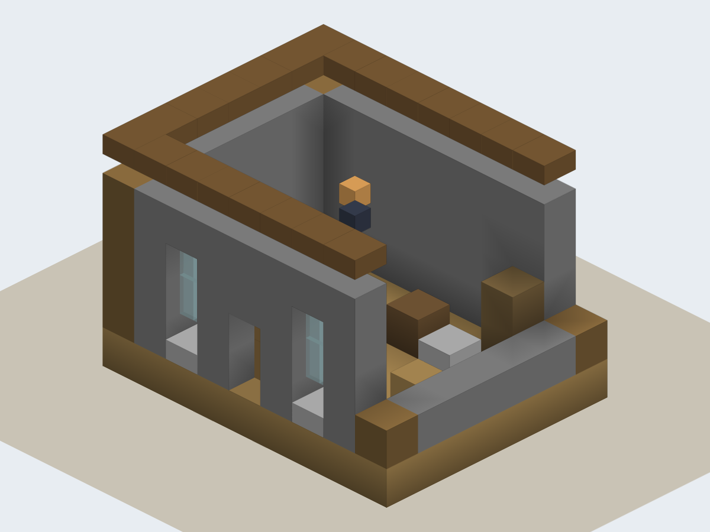

# 拼图花园（Puzzle Garden）

> 一句自然语言需求 → 可施工的体素建筑。  
> From one sentence to a buildable voxel building.

拼图花园是一个面向 **体素建筑生成** 的研究型 agent 项目：模型先产出设计意图（DesignIntent），宿主把它展开成可施工的设计方案、设计报告与构建任务书；随后构建 agent 在隔离沙箱里写 TypeScript、调用 World API 建造、用分析 / 渲染 / 一致性检查自我验证，最后产出存档、渲染图与评审报告。

> **状态：`0.3.0-beta.0`，研究原型。** 离线链路、mock 流程与质量门禁是完整的；live 全链路仍在迭代，生成质量、轮数与费用都会波动。请先跑 mock / example，确认理解成本模型后再开 live。



_上图是项目自产的 fallback 渲染（不包含 Minecraft 官方贴图）。_

## 特性

- **设计先行**：`RequirementGraph → DesignIntent → DesignScheme + DesignReport + BuildBrief + SVG 预览`，用户确认后才进入施工。
- **Agent 施工**：单一主循环 + 护栏（轮数 / 上下文 / 花费 / 卡死 / 退化 / 无工具），工具包括读写代码、检查、看图、提交。
- **真沙箱**：生成的 TypeScript 在 `bwrap` 中执行（`--unshare-all`、`--clearenv`、`--cap-drop ALL`、只读挂载、Node `--permission` 模型、内存 / 时间上限）。
- **可验证**：体素存档（PGAR）、对象级一致性 diff、41 条 must 的叶子级证据、12 个离线 conformance case（4 类房子 × 3 种样本）、构建后评审与接受门槛。
- **可看**：Chrome + three.js 渲染，网页工作台（SSE 进度、设计预览、构建渲染、下载）。
- **可复现**：离线门禁不联网、不花钱；live 调用需要显式确认与单次预算上限。

## 环境要求

| 依赖                     | 要求                            | 说明                                                                                         |
| ------------------------ | ------------------------------- | -------------------------------------------------------------------------------------------- |
| Node.js                  | `>=24.19.0 <25`                 | 直接运行 `.ts`（Node 原生类型剥离），见 `.nvmrc`                                             |
| 操作系统                 | Linux                           | 沙箱依赖 `bwrap`（bubblewrap）；没有 bwrap 时集成测试自动 skip，live 构建不可用              |
| Chrome / Chromium        | `>=154`                         | 渲染用；默认查找 `/usr/bin/google-chrome`                                                    |
| LLM                      | OpenAI 兼容 `/chat/completions` | 当前入口只接受 `PG_LLM_MODEL=deepseek-flash`；live 还需 `PG_LLM_BASE_URL` / `PG_LLM_API_KEY` |
| Minecraft 1.20.1（可选） | 本机 client jar                 | 官方贴图 / 模型只导入到 `.work/`，**不随仓库分发**                                           |

## 快速开始（离线，不花钱）

```bash
git clone https://github.com/xingzihai/puzzle-garden.git
cd puzzle-garden
npm ci                 # 同时启用 .githooks（提交前快速检查、推送前完整门禁）

npm run check          # 离线门禁：格式 / 类型 / ESLint / 依赖 / 资产 / 测试 / 覆盖率
npm run design:example # 用内置示例走一遍设计产物（不调用模型）
npm run design:web:mock
# 打开 http://127.0.0.1:4174
```

`npm run check` 不会联网、不会调用模型、不会花钱；集成测试（真实 bwrap / 浏览器）不在这条命令里。

## 使用真实模型（会产生费用）

```bash
cp .env.example .env
# 填写 PG_LLM_BASE_URL / PG_LLM_API_KEY / PG_LLM_MODEL
npm run design:web:live
```

- `design:web:live` 会设置 `PG_LIVE_CONFIRM=1` 并带 `--live`；没有该确认时入口会拒绝联网。
- 单次 run 的费用上限由 `PG_MAX_RUN_COST_CNY` 与命令行 `--max-cny` 的较小值决定（默认 3.5 元）。
- 设计 + 构建的真实花费会写入 `.work/live-audit/`；请先用 `PG_MAX_RUN_COST_CNY` 设一个你愿意承担的上限。

## 常用命令

| 命令                                                    | 作用                                                      |
| ------------------------------------------------------- | --------------------------------------------------------- |
| `npm run check`                                         | 完整离线门禁（CI 同款 8 步；CI 另跑 `check:conformance`） |
| `npm test`                                              | 只跑单元测试                                              |
| `npm run test:integration`                              | 集成测试（需要 bwrap / Chrome）                           |
| `npm run typecheck` / `npm run lint` / `npm run format` | 类型 / 规范 / 格式化                                      |
| `npm run design:example`                                | 离线设计示例                                              |
| `npm run design:web:mock`                               | mock 网页工作台（127.0.0.1:4174）                         |
| `npm run design:web:live`                               | live 网页工作台（花钱）                                   |
| `npm run agent`                                         | 构建 agent CLI                                            |
| `npm run bench`                                         | 性能基准（不进门禁）                                      |
| `npm run check:conformance`                             | 12 个离线 conformance case（`--strict`）                  |

## 项目结构

```text
packages/
  agent/        主循环、护栏、提示词、工具
  analysis/     可达 / 悬空 / 对称 / 接缝 / 屋面轮廓
  blocks/       方块注册表、调色板、材质族
  config/       唯一读取环境变量的地方
  core/         坐标、方块状态、网格、PGAR 归档、哈希、RNG
  design/       Blueprint schema、检查、差分、示例方案
  geometry/     World API：世界、墙、屋顶、壳体、碰撞、Writer
  interaction/  需求图、DesignIntent、方案 / 报告 / 构建任务书
  llm/          LLM 客户端、SSE、请求 schema、计费、mock
  modeling/     Model API：参数化部件、网格、变换、体素化
  render/       Chrome + three.js 渲染、相机、场景缓冲
  sandbox/      bwrap 隔离、类型预检、体素 / 建模子进程
  store/        run 目录、事件、Blob、请求编码、trace 派生
  web/          只读查看器、页面、模型截图
tools/          CLI、批跑、基准、资产 / 依赖检查
assets/         方块数据、基准资产（来源见 assets/README.md）
benchmark/      M1 / 建模题面
docs/           架构、规格、用法与交接文档（入口 docs/README.md）
```

更完整的包职责、依赖方向与数据流见 [`docs/ARCHITECTURE.md`](docs/ARCHITECTURE.md)。

## 文档

| 文档                                                       | 内容                                        |
| ---------------------------------------------------------- | ------------------------------------------- |
| [`docs/README.md`](docs/README.md)                         | 文档索引与当前主线                          |
| [`docs/ARCHITECTURE.md`](docs/ARCHITECTURE.md)             | 分层、包职责、关键流程、质量门禁            |
| [`docs/INTERACTION-USAGE.md`](docs/INTERACTION-USAGE.md)   | CLI / 网页 / 构建交接怎么用                 |
| [`docs/DESIGN-INTENT-SPEC.md`](docs/DESIGN-INTENT-SPEC.md) | DesignIntent 与宿主展开契约                 |
| [`docs/MC-ASSETS.md`](docs/MC-ASSETS.md)                   | Minecraft 官方资源导入与合规边界            |
| [`assets/README.md`](assets/README.md)                     | 资产来源、许可证与更新方式                  |
| [`AGENTS.md`](AGENTS.md)                                   | 给 AI 编码代理的项目规则（Graphify 工作流） |

## 质量与基准

- `npm run check`：格式、类型、ESLint、依赖声明、资产 sha256、测试配对、单元测试 + 覆盖率、工具测试。
- `npm run check:conformance`：4 类房子 × 3 类样本，12/12 met，`--strict` 退出码 0。
- 构建自证：对象图 + 通用 diff + 41 条 must 的叶子级证据；未归因 hard fail 与任何 not-met leaf 都会阻断 accept。
- 仓库内的 `tools/fixtures/` 保存了可离线重放的冻结证据（run-7 / run-9 / live-run），测试会校验 sha256 与逐字段一致性。

具体数字以当前代码和 `npm run check` 为准；历史基线见 [`docs/README.md`](docs/README.md)。

## 已知限制

- **Linux only**：沙箱依赖 `bwrap`；macOS / Windows 只能跑不依赖沙箱的单元测试与部分工具。
- **live 质量不稳定**：模型可能写出不可施工的代码、反复试错或超预算；护栏会止损，但不保证交付。
- **不内置游戏资源**：没有 Minecraft client jar 时渲染自动回退到平均色 + 简化几何。
- **不是生产服务**：网页服务只监听 `127.0.0.1`，没有多用户、鉴权或公网部署设计。
- **费用**：live 调用真实 LLM，按 token 计费；请先读预算文档并从小上限开始。

## 贡献与安全

- 贡献指南：[`CONTRIBUTING.md`](CONTRIBUTING.md)
- 行为准则：[`CODE_OF_CONDUCT.md`](CODE_OF_CONDUCT.md)
- 安全策略与威胁模型：[`SECURITY.md`](SECURITY.md)
- 变更记录：[`CHANGELOG.md`](CHANGELOG.md)

## 许可证与声明

- 代码以 **Apache-2.0** 发布，见 [`LICENSE`](LICENSE) 与 [`NOTICE`](NOTICE)。
- 第三方组件与数据的许可证见 [`THIRD_PARTY_NOTICES.md`](THIRD_PARTY_NOTICES.md)。
- **Minecraft** 是 Mojang Synergies AB 的商标。本项目不是 Minecraft 官方产品，与 Mojang Studios / Microsoft 无隶属或背书关系；当前源码树不包含游戏 jar、官方贴图、官方模型或官方资源渲染图（历史提交中可能仍有早期文件）。
- **DeepSeek** 是其权利人的商标。本项目与 DeepSeek 无隶属或背书关系。
