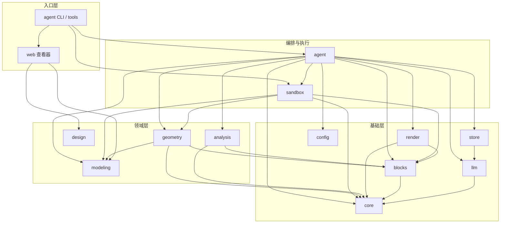

# 拼图花园架构说明

> 适用版本：`0.3.0-beta.0`  
> 整理日期：2026-10-19  
> 2026-10-20 补充：新增 `@pg/interaction`（用户交互层）与 MC 官方资源管线；交互层用法见 `docs/INTERACTION-USAGE.md`，数据契约见 `docs/DESIGN-INTENT-SPEC.md`。2026-11-11：包清单已补 `interaction`，层级图仍以构建链路为主。
> 知识图谱：4583 节点 / 12306 边 / 214 社区（Graphify 0.9.92，基于提交 `01c1994`）  
> 本文是开发导航，不替代代码与测试；若与代码冲突，以代码和测试为准。

## 1. 项目定位

拼图花园把一句自然语言需求（题面）变成可执行的体素建筑：

1. Agent 读取题面，写出建筑代码；
2. 代码在隔离沙箱里执行，产出体素存档或参数化模型；
3. 分析、渲染和检查结果回喂给 Agent；
4. Agent 根据反馈迭代，最后提交交付。

项目有两条并行的建模链路：

| 链路       | 输入                   | 中间产物                       | 主要包                              |
| ---------- | ---------------------- | ------------------------------ | ----------------------------------- |
| 体素建筑   | 建筑代码调用 World API | `PGAR` 存档 + `Grid`           | `geometry` / `core` / `analysis`    |
| 参数化草模 | 建模代码调用 Model API | `ModelDocument`（部件 + 网格） | `modeling` / `sandbox` / `geometry` |

运行时要求：Node.js `>=24.19.0 <25`，ESM，npm workspaces。

## 2. 目录结构

```text
.
├── packages/                  # 14 个工作区包
│   ├── agent/                 # Agent 主循环、护栏、提示词、工具
│   ├── analysis/              # 可达、悬空、对称、接缝、屋顶轮廓
│   ├── blocks/                # 方块注册表、调色板、材质族
│   ├── config/                # 唯一读取环境变量的地方
│   ├── core/                  # 纯函数核心：坐标、方块状态、网格、归档、哈希、RNG
│   ├── design/                # Blueprint schema、检查、差分、示例方案
│   ├── geometry/              # World API：世界、墙、屋顶、壳体、碰撞、Writer
│   ├── interaction/           # 需求图、DesignIntent、方案 / 报告 / 构建任务书
│   ├── llm/                   # LLM 客户端、SSE、请求 schema、计费、mock
│   ├── modeling/              # Model API：参数化部件、网格、变换、体素化
│   ├── render/                # Chrome + three 渲染、相机、场景缓冲
│   ├── sandbox/               # bwrap 隔离、类型预检、体素/建模子进程
│   ├── store/                 # run 目录、事件、Blob、请求编码、trace 派生
│   └── web/                   # 只读查看器服务、页面、模型截图
├── tools/                     # CLI、批跑、基准、资产/依赖检查
├── benchmark/                 # M1 / 建模题面
├── assets/                    # 方块数据、调色板、基准资产
├── generated/                 # 生成的 World API 文档
├── .opencode/                 # OpenCode Graphify 技能与插件
└── graphify-out/              # 知识图谱、报告、可视化（本地生成物，不入库）
```

## 3. 分层与依赖



依赖方向的基本规则：

- `core`、`modeling`、`design`、`config` 是低层包，不反向依赖业务编排。
- `geometry` 依赖 `core` + `blocks` + `modeling`，不依赖 `agent` / `sandbox` / `web`。
- `sandbox` 只负责隔离执行，不发起 LLM 请求。
- `agent` 是唯一同时接触 LLM、存储、沙箱、几何、分析和渲染的编排层。
- `web` 只依赖 `design` + `modeling`，保持查看器轻量。
- `tools` 是组装层，可以把 `agent`、`web`、`sandbox` 等接在一起。

图谱检测结果：**没有导入环**。

## 4. 包职责

| 包                | 职责                                                                                                     | 关键入口                                         |
| ----------------- | -------------------------------------------------------------------------------------------------------- | ------------------------------------------------ |
| `@pg/core`        | 坐标、方块状态规范化、稀疏体素网格、`PGAR` 归档、哈希、确定性 RNG；零 I/O                                | `grid.ts` / `block-state.ts` / `archive.ts`      |
| `@pg/blocks`      | 从 `assets/` 加载方块表，提供注册表、颜色和材质族                                                        | `load.ts` / `registry.ts` / `color.ts`           |
| `@pg/modeling`    | `createModel()` 记录参数化部件；box / revolve / extrude / surface / bezier；网格与变换                   | `model.ts` / `schema.ts`                         |
| `@pg/geometry`    | `createWorld()` 提供 World API：台基、墙、门窗、楼板、楼梯、屋顶、柱廊、栏杆、院墙、铺装、壳体、草模导入 | `world.ts` / `writer.ts` / `schema.ts`           |
| `@pg/analysis`    | 对 `Grid` 做可达、悬空、对称、接缝、屋顶轮廓等测量                                                       | `reach.ts` / `floating.ts` / `symmetry.ts`       |
| `@pg/design`      | `Blueprint` schema、净空检查、版本差分、示例方案                                                         | `schema.ts` / `checks.ts` / `diff.ts`            |
| `@pg/interaction` | 需求图、DesignIntent、方案 / 报告 / 构建任务书、会话存储与网页 API                                       | `scheme.ts` / `build.ts` / `session.ts`          |
| `@pg/render`      | 解析 `PGAR`、网格化、相机取景、驱动 Chrome 渲染                                                          | `render.ts` / `browser.ts`                       |
| `@pg/web`         | 只读本地查看器、页面模块、模型三视图截图                                                                 | `server.ts` / `page/main.ts` / `model-render.ts` |
| `@pg/sandbox`     | 类型预检、bwrap 子进程、体素/建模执行、协议与逃逸防护                                                    | `precheck.ts` / `run.ts` / `modeling.ts`         |
| `@pg/agent`       | 单次 run 的主循环、10 个工具、护栏、提示词、体素/建模 target                                             | `runner.ts` / `turn-tools.ts` / `guards/`        |
| `@pg/llm`         | 流式 Chat Completions 客户端、SSE 拼装、重试、计费、mock                                                 | `client.ts` / `sse.ts` / `cost.ts`               |
| `@pg/store`       | `.work/runs/<runId>/`、`events.jsonl`、Blob、请求编码、trace 派生                                        | `run-dir.ts` / `events.ts`                       |
| `@pg/config`      | 读取并校验 `PG_*` 环境变量，非法值直接报错                                                               | `config.ts`                                      |

## 5. 关键运行流程

### 5.1 体素 Agent 的一次 run

入口有两类：

- `packages/agent/src/cli.ts`：包内组装，不能依赖 `@pg/web`，因此没有草模截图宿主；
- `tools/agent-massing.ts`：tools 层组装，接入真实 `@pg/web/model-render` 与 massing host。

主流程：

```text
解析参数 / 读题
  → 创建 run 目录（.work/runs/<runId>/）
  → run.start + prompt.system
  → 每一轮：
      请求前护栏（wall / cost / turns / cost-window / wall-window / context / image）
      → client.complete 流式请求
      → 记录 llm.request / llm.attempt / llm.response
      → 工具分发（write_code / edit_code / read_code / check_code /
                  view_building / submit / write_design / read_design /
                  massing / read_massing）
      → 沙箱执行、渲染、分析
      → 轮末护栏（degenerate / stuck / no-tool）
      → 事实行 + 本轮图片
  → 交付或停止
  → run.end + trace.json
```

关键模块：

| 模块               | 作用                                                                       |
| ------------------ | -------------------------------------------------------------------------- |
| `runner.ts`        | 唯一主循环；只做编排，依赖全部注入                                         |
| `runner-guards.ts` | 护栏顺序与事件数值                                                         |
| `guards/*.ts`      | 墙钟、金额、轮数、上下文、图片、退化、卡死、无工具调用                     |
| `turn-tools.ts`    | 工具分发、版本保存、提交窗口、同轮视图去重                                 |
| `tool-stage.ts`    | 工具阶段的墙钟与外部取消，防止后台工具在 `run.end` 后写事件                |
| `budget.ts`        | 父预算与草模子运行的预留/结算                                              |
| `store`            | 事件、Blob、交付文件；事件行上限 256 KiB，禁止 `data:image` 和疑似 API key |
| `sandbox`          | 预检 + bwrap 执行；体素与建模两条子进程协议                                |

停止原因统一由 `@pg/store/events` 的 `StopReason` 定义，包括：`cost-budget`、`max-turns`、`wall`、`context-limit`、`image-budget`、`degenerate-loop`、`stuck`、`no-tool`、`llm-error`、`sandbox-unsupported`、`internal-error`、`cancelled`。

### 5.2 参数化草模链路

```text
建模代码（隔离进程）
  → createModel().box / revolve / extrude / surface / bezier
  → finish() 返回 ModelDocument
  → sandbox/modeling 校验 documentHash
  → geometry/massing-import 或 voxelize-cells 转成体素/World
  → web/model-render 截取整体/俯视/侧视三视图
  → 作为图片与事实回喂 Agent
```

`ModelDocument` 的约束：

- 部件角色：`volume` / `roof` / `floor` / `connection`；
- 最多 128 个部件、200k 顶点、400k 三角面；
- 颜色统一小写 `#rrggbb`；
- `finish()` 后返回独立快照，不能继续添加部件。

### 5.3 查看器链路

```text
web/cli.ts
  → startMassingServer({ port, model? })
  → 仅监听 127.0.0.1
  → 白名单静态资源 + /api/blueprints + /api/report
  → page/main.ts 绑定 DOM、相机、楼层/剖切/高亮控件
  → design/checks + design/diff 生成报告
```

安全边界：

- 只读，不接受写请求或请求体；
- 不做 CORS；
- 不按请求拼接任意文件路径；
- 页面只消费 schema 校验后的 Blueprint / ModelDocument；
- 渲染进程只关闭自己启动的 Chrome，不按进程名全局清理。

## 6. 数据与不变量

| 对象            | 关键不变量                                                  |
| --------------- | ----------------------------------------------------------- |
| 坐标            | x 向东、y 向上、z 向南；坐标为整数                          |
| `BlockState`    | 规范化字符串；三种空气统一为 `air`；属性按键排序            |
| `Grid`          | 16³ 稀疏区块；后写覆盖；每格记录部件、调用和来源            |
| `PGAR` 归档     | magic `PGAR`、版本 1；只接受规范字节形式                    |
| `ModelDocument` | 严格 schema、部件 id 唯一、顶点/三角面上限、快照不可变      |
| `Blueprint`     | 严格只读结构、id 唯一、跨集合引用完整                       |
| `events.jsonl`  | `seq` 从 0 连续；单行 ≤ 256 KiB；大对象走 Blob 引用         |
| 金额            | 以元 × 1e8 的整数记账；子运行先预留、后按实际结算           |
| 沙箱            | 代码 ≤ 256 KiB；默认墙钟 30 s；bwrap 不可用时明确返回不支持 |
| 配置            | 只认 `PG_` 前缀；非法值一次列全；报错不回显密钥             |

## 7. 测试与质量门禁

```bash
npm run typecheck        # 三套 tsconfig
npm run lint             # ESLint，零警告
npm run test             # 单元测试（禁止真实网络）
npm run test:coverage    # 覆盖率门槛：行 90 / 分支 85 / 函数 90
npm run test:integration # 集成测试（沙箱 / 渲染 / 浏览器）
npm run check            # 离线总门禁
npm run bench            # 性能基准，写入 .work/bench/
```

测试约定：

- 单元测试通过 `tools/test-no-network.ts` 把 `globalThis.fetch` 替换为抛错函数；
- HTTP 请求通过依赖注入 mock，不读全局 `fetch`；
- 浏览器/沙箱相关用集成测试，不进入默认单测；
- 性能断言只放 `bench.ts`，不写进单测；
- `check-tests.ts` 检查源码与测试配对，浏览器入口等例外需登记。

当前图谱统计：212 个测试文件 / 175 个源码文件（约 1.21），`agent`、`sandbox`、`geometry` 的测试最多。

## 8. Graphify 工作流

本仓库已把知识图谱接入 OpenCode 与 git hook。

### 查询

```bash
graphify query "agent 的预算和上下文护栏如何工作" --seed runRun --context call --budget 1500
graphify explain "createWorld"
graphify path "createWorld" "writeArchive" --undirected
graphify affected "createModel" --depth 2
graphify god-nodes --top 15
```

优先用图谱定位，再读具体源码行：

- 架构问题：`graphify query`
- 单点概念：`graphify explain`
- 两个模块的关系：`graphify path`
- 改动的反向影响：`graphify affected`
- 全局枢纽：`graphify god-nodes`

### 更新

```bash
# 只改代码：纯 AST 增量更新，不花 API 费用
graphify update .

# 改了文档/基准题：重新做语义抽取（有缓存，只处理变更文件）
graphify extract . --backend deepseek --model deepseek-flash
graphify cluster-only . --backend=deepseek --model=deepseek-flash
```

`graphify hook install` 已注册 post-commit / post-checkout / post-merge / post-rewrite 钩子：提交后会自动对代码做 AST 更新。

> graphify-out/ 是**本地生成物，不入库**（已 gitignore）：新克隆仓库后需要先安装 Graphify，
> 并在仓库根目录跑一次 `graphify build .`（或 `graphify update .`）生成本地图谱；查询前先确认 `graphify-out/graph.json` 存在。

### 产物（本地）

| 文件                                       | 用途                                     |
| ------------------------------------------ | ---------------------------------------- |
| `graphify-out/graph.json`                  | 完整图谱，供 query / path / explain 使用 |
| `graphify-out/GRAPH_REPORT.md`             | 架构报告、核心枢纽、知识缺口             |
| `graphify-out/graph.html`                  | 可交互图谱                               |
| `graphify-out/puzzle-garden-callflow.html` | 中文架构/调用流视图                      |
| `graphify-out/sections.json`               | 调用流视图的包分组                       |
| `graphify-out/manifest.json`               | 增量更新清单                             |

## 9. 影响面速查

图谱中连接度最高的文件：

| 文件                               | 说明                                        |
| ---------------------------------- | ------------------------------------------- |
| `packages/geometry/src/schema.ts`  | World API 全部构件的 zod schema 与 `rect()` |
| `packages/modeling/src/schema.ts`  | `ModelDocument`、部件、变换、上限           |
| `packages/core/src/grid.ts`        | 网格、区块、部件/调用表                     |
| `packages/core/src/block-state.ts` | 方块状态解析与规范化                        |
| `packages/web/src/page/main.ts`    | 查看器 DOM 与交互编排                       |
| `packages/web/src/page/scene.ts`   | 场景构建与选择                              |
| `packages/store/src/events.ts`     | 事件 schema、`RunLimits`、`StopReason`      |
| `packages/sandbox/src/run.ts`      | 体素沙箱执行与结果分类                      |
| `packages/geometry/src/writer.ts`  | 分层写入、冲突索引、覆盖报告                |
| `packages/core/src/archive.ts`     | `PGAR` 读写                                 |
| `packages/agent/src/runner.ts`     | Agent 主循环                                |

核心枢纽：

| 枢纽             | 位置                               | 连接数 |
| ---------------- | ---------------------------------- | ------ |
| `createWorld()`  | `packages/geometry/src/world.ts`   | 85     |
| `createModel()`  | `packages/modeling/src/model.ts`   | 83     |
| `rect()`         | `packages/geometry/src/schema.ts`  | 75     |
| `loadRegistry()` | `packages/blocks/src/load.ts`      | 64     |
| `parseState()`   | `packages/core/src/block-state.ts` | 61     |
| `start()`        | `packages/web/src/page/main.ts`    | 55     |
| `ModelDocument`  | `packages/modeling/src/schema.ts`  | 51     |
| `Grid`           | `packages/core/src/grid.ts`        | 49     |
| `writeArchive()` | `packages/core/src/archive.ts`     | 48     |
| `hashGrid()`     | `packages/core/src/hash.ts`        | 46     |
| `runRun()`       | `packages/agent/src/runner.ts`     | 44     |

改动建议：

1. 改 `geometry/schema.ts`、`modeling/schema.ts` 前先跑 `graphify affected`，确认影响面。
2. 改 `core/grid.ts` 或 `core/block-state.ts` 后，至少跑 `npm run test` + `npm run test:integration`。
3. `agent` 是最大包（约 17.9k LOC、100 个文件），新功能优先放到独立模块，避免继续扩大 `runner.ts`。
4. 图谱社区命名是拓扑启发式；报告里的“拆分建议”只作线索，不作为重构结论。
5. 81 个孤立节点主要是外部依赖（`zod`、`@pg/llm`、`eslint` 等）；47 个无符号文件基本是测试或数据文件，不代表代码缺失。

## 10. 常用命令

```bash
# 应用
npm run massing                 # 启动草模查看器
npm run model:build -- <code> <out>
npm run model:agent -- --demo
npm run agent -- --help
npm run agent:massing -- --help

# 质量
npm run check
npm run test
npm run test:integration
npm run bench

# 图谱
graphify query "..."
graphify explain "..."
graphify affected "..."
graphify update .
```

## 附录：图谱快照

- 节点：4583
- 边：12306
- 社区：214（报告中展示 202 个，12 个薄社区省略）
- 置信度：98% EXTRACTED / 2% INFERRED / 0% AMBIGUOUS（272 条 INFERRED 边，平均置信度 0.84）
- 导入环：0
- 悬空/重复边：0
- 自环：24
- Token 缩减基准：187.5x
- 构建提交：`01c1994`

完整数据见 `graphify-out/GRAPH_REPORT.md` 与 `graphify-out/.graphify_analysis.json`。
